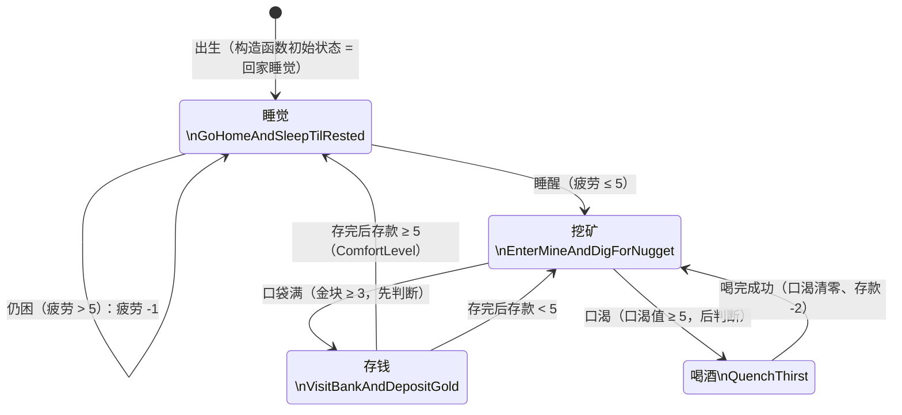

# Miner Bob 状态机流程图（WestWorld1）

> 来源：Buckland《Programming Game AI by Example》第 2 章示例 1
> 核心机制：有限状态机（FSM）—— 状态模式（State Pattern）+ 单例（Singleton）
> 驱动方式：`main.cpp` 循环调用 `miner.Update()` 20 次；`Update()` 每次先口渴 +1，再把行动决策交给当前状态的 `Execute()`；切换走 `Miner::ChangeState()`（旧状态 Exit → 换指针 → 新状态 Enter）。

## 一、Mermaid 状态转化图

## 二、状态与地点对照

| 状态类（单例） | 含义 | 所在位置（location_type） |
|---|---|---|
| `EnterMineAndDigForNugget` | 挖矿：每步金块 +1、疲劳 +1 | goldmine 金矿 |
| `VisitBankAndDepositGold` | 存钱：金块全换存款、口袋清零 | bank 银行 |
| `GoHomeAndSleepTilRested` | 睡觉：每步疲劳 -1 | shack 小屋 |
| `QuenchThirst` | 喝酒：口渴清零、存款 -2 | saloon 酒吧 |

## 三、切换规则与阈值常量（定义在 Miner.h）

| 切换 | 条件 | 常量 |
|---|---|---|
| 挖矿 → 存钱 | 口袋金块 ≥ 3 | `MaxNuggets = 3` |
| 挖矿 → 喝酒 | 口渴值 ≥ 5 | `ThirstLevel = 5` |
| 存钱 → 睡觉 | 存款 ≥ 5 | `ComfortLevel = 5` |
| 存钱 → 挖矿 | 存款 < 5 | `ComfortLevel = 5` |
| 睡觉 → 挖矿 | 疲劳 ≤ 5（Fatigued() = 疲劳 > 5） | `TirednessThreshold = 5` |
| 喝酒 → 挖矿 | 喝完成功（Thirsty() 为真时执行） | — |

## 四、关键细节

1. **挖矿状态的判断优先级**：`Execute()` 里先查 `PocketsFull()` 再查 `Thirsty()` —— 若同时"口袋满"且"口渴"，先去银行存钱。
2. **睡觉状态自循环**：疲劳 > 5 时留在睡觉状态并执行 `DecreaseFatigue()`（疲劳 -1）；降到 ≤ 5 才切回挖矿。
3. **初始状态**：构造函数把 `m_pCurrentState` 设为 `GoHomeAndSleepTilRested::Instance()`，但出生时疲劳 = 0，第一次 `Update()` 即"睡醒"直接去挖矿。
4. **喝酒状态的防御检查**：进入后若 `Thirsty()` 为假（正常流程不会发生），打印 `ERROR!` 且不切换。
