# Steering 工程完整流程图（Buckland 第三章 · Steering Behaviors）

> 工程位置：`Buckland_Chapter3-Steering Behaviors/Steering.sln`
> 本文档基于对全部源码（`main.cpp`、`GameWorld.h/.cpp`、`Vehicle.h/.cpp`、`SteeringBehaviors.h/.cpp`、`MovingEntity.h`、`BaseGameEntity.h`、`Obstacle.h/.cpp`、`Path.h/.cpp`、`ParamLoader.h/.cpp`、`EntityFunctionTemplates.h`、`constants.h`、`params.ini`）的通读整理。
>
> 一句话理解本工程：**一个 Windows 图形窗口程序，300 辆"小鱼"机器人通过 16 种转向行为在屏幕上成群飞行**，最后一辆被改造成巨大的"鲨鱼"，其余小鱼全部开启"逃命"行为躲着它。核心是每帧循环执行 **"行为 → 转向力 → 合力 → 加速度 → 速度 → 位置"** 的物理循环。

---

## 目录

1. [工程文件地图（依赖关系）](#1-工程文件地图依赖关系)
2. [类继承关系图](#2-类继承关系图)
3. [程序启动流程（WinMain）](#3-程序启动流程winmain)
4. [窗口消息处理（WindowProc）](#4-窗口消息处理windowproc)
5. [世界构造流程（GameWorld 构造函数）](#5-世界构造流程gameworld-构造函数)
6. [主循环单帧运行流程](#6-主循环单帧运行流程)
7. [转向力计算流程（SteeringBehavior::Calculate）](#7-转向力计算流程steeringbehaviorcalculate)
8. [三种合力合成方式](#8-三种合力合成方式)
9. [16 个转向行为算法一览](#9-16-个转向行为算法一览)
10. [渲染流程](#10-渲染流程)
11. [用户交互处理](#11-用户交互处理)

---

## 1. 工程文件地图（依赖关系）

```mermaid
flowchart TD
    subgraph LOCAL["本工程文件"]
        MAIN[main.cpp<br/>程序入口：建窗口→建世界→消息循环]
        GW_H[GameWorld.h]
        GW_CPP[GameWorld.cpp<br/>世界容器/更新/渲染/交互]
        VEH_H[Vehicle.h]
        VEH_CPP[Vehicle.cpp<br/>转向力→加速度→速度→位置]
        SB_H[SteeringBehaviors.h<br/>行为开关位表+接口]
        SB_CPP[SteeringBehaviors.cpp<br/>16个行为算法+3种合力]
        MOVE[MovingEntity.h<br/>速度/朝向/质量/推力]
        BASE[BaseGameEntity.h<br/>编号/位置/半径/标记]
        OBS[Obstacle.h/.cpp<br/>圆形障碍物]
        PATH[Path.h/.cpp<br/>路径：路标点链表]
        PRM[ParamLoader.h/.cpp<br/>读取 params.ini]
        TPL[EntityFunctionTemplates.h<br/>打标记/防穿模模板]
        CONST[constants.h<br/>窗口尺寸常量]
        INI[params.ini<br/>全部数值参数]
    end

    subgraph COMMON["Common 共享目录（只使用不修改）"]
        VEC[2D/Vector2D.h<br/>向量运算]
        GEO[2D/Geometry.h<br/>几何工具]
        WALL[2D/Wall2D.h<br/>墙段]
        TRANS[2D/Transformations.h<br/>坐标变换]
        MAT[2D/C2DMatrix.h<br/>旋转矩阵]
        BOX[2D/InvertedAABBox2D.h<br/>AABB包围盒]
        SMOOTH[misc/Smoother.h<br/>滑动平均平滑器]
        CELL[misc/CellSpacePartition.h<br/>网格空间划分]
        CGDI[misc/Cgdi.h<br/>绘图单例 gdi]
        INILOAD[misc/iniFileLoaderBase.h<br/>ini读取基类]
        WUTILS[misc/WindowUtils.h<br/>菜单工具]
        UTILS[misc/utils.h<br/>随机数/工具]
        TIMER[Time/PrecisionTimer.h<br/>高精度计时器]
    end

    MAIN --> GW_H
    MAIN --> CONST
    MAIN --> TIMER
    MAIN --> CGDI
    MAIN --> PRM
    MAIN --> WUTILS
    MAIN --> UTILS

    GW_CPP --> GW_H
    GW_H --> VEH_H
    GW_H --> BASE
    GW_H --> TPL
    GW_H --> CELL
    GW_H --> VEC
    GW_CPP --> OBS
    GW_CPP --> PATH
    GW_CPP --> PRM
    GW_CPP --> WALL

    VEH_H --> MOVE
    VEH_H --> SMOOTH
    VEH_CPP --> SB_H
    VEH_CPP --> TRANS
    VEH_CPP --> CGDI

    MOVE --> BASE
    OBS --> BASE

    SB_H --> VEH_H
    SB_H --> PATH
    SB_H --> PRM
    SB_CPP --> WALL
    SB_CPP --> TRANS
    SB_CPP --> GEO
    SB_CPP --> CELL
    SB_CPP --> CGDI

    PRM --> INILOAD
    PRM --> INI
    PATH --> VEC
```

---

## 2. 类继承关系图

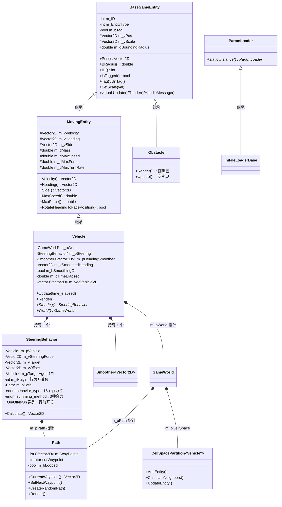

---

## 3. 程序启动流程（WinMain）

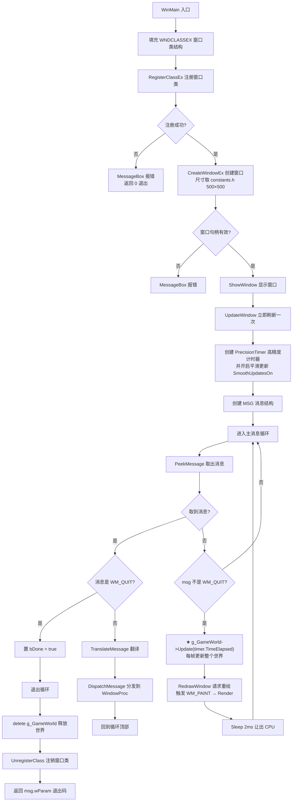

**要点**：窗口创建时会先收到 `WM_CREATE` 消息（见下一节），在那里完成后备缓冲创建与 `GameWorld` 的构建；之后主循环每帧交替执行 **取消息 → 更新世界 → 请求重绘**。

---

## 4. 窗口消息处理（WindowProc）

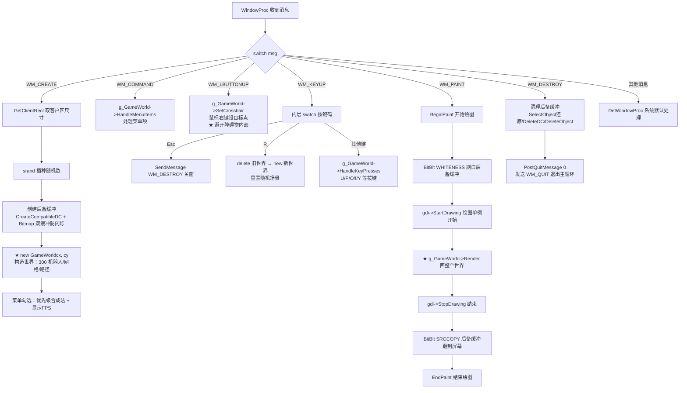

---

## 5. 世界构造流程（GameWorld 构造函数）

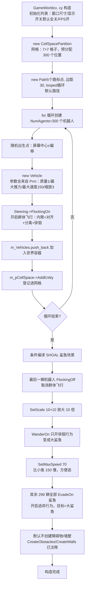

**场景说明**：默认 `params.ini` 参数（300 机器人、7×7 网格、各行为权重、Evade 权重 0.01、FollowPath 权重 0.05 等）由 `ParamLoader` 单例（宏 `Prm`）在程序启动时一次性读出。

---

## 6. 主循环单帧运行流程

这是整个工程的心脏：**每帧（约每 2ms 节流一次）驱动所有机器人移动**。

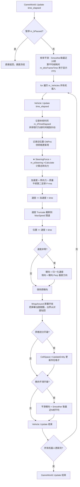

---

## 7. 转向力计算流程（SteeringBehavior::Calculate）

`Vehicle::Update` 每帧调用它一次，返回"总转向力"。

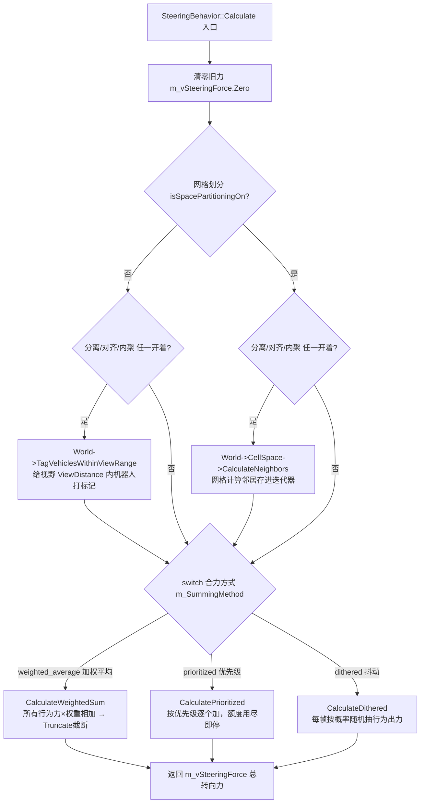

---

## 8. 三种合力合成方式

### 8.1 优先级合成法（默认，CalculatePrioritized）

**处理顺序 = 行为重要程度从高到低**；每个行为算出力后累加，一旦 `AccumulateForce` 判定"额度用尽"立刻返回，后面的低优先级行为不再参与。

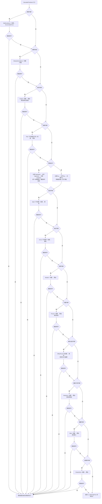

> 权重来自 `params.ini`（经 `Prm.SteeringForceTweaker` 缩放）。`AccumulateForce` 保证总力不超过车辆 `MaxForce`。

### 8.2 加权平均法（CalculateWeightedSum）

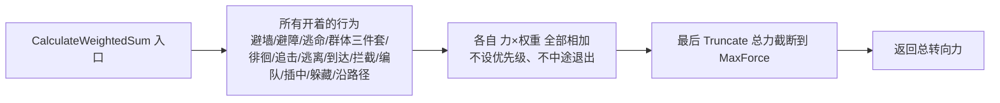

### 8.3 抖动合成法（CalculateDithered）

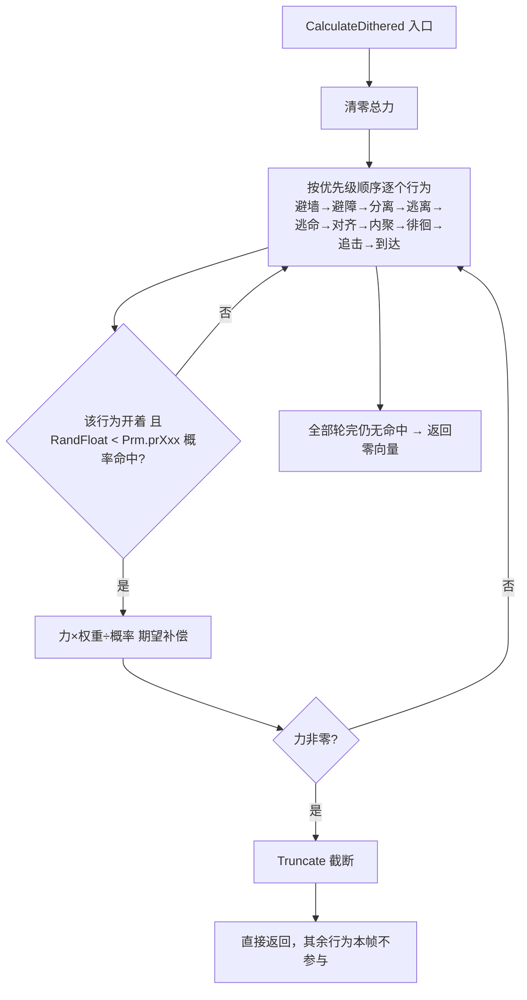

---

## 9. 16 个转向行为算法一览

每个行为算法返回一个"转向力向量"，核心公式是 **转向力 = 期望速度 − 当前速度**（速度差）。

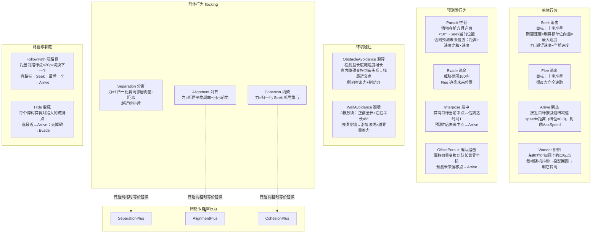

**行为开关位表**（`m_iFlags` 一个 int 的 16 个位）：

| 位 | 行为 | 位 | 行为 |
|---|---|---|---|
| 0x00002 | seek 追击 | 0x00800 | pursuit 拦截 |
| 0x00004 | flee 逃离 | 0x01000 | evade 逃命 |
| 0x00008 | arrive 到达 | 0x02000 | interpose 插中 |
| 0x00010 | wander 徘徊 | 0x04000 | hide 躲藏 |
| 0x00020 | cohesion 内聚 | 0x08000 | flock 群体飞行组合 |
| 0x00040 | separation 分离 | 0x10000 | offset_pursuit 编队追击 |
| 0x00080 | allignment 对齐 | — | — |
| 0x00100 | obstacle_avoidance 避障 | — | — |
| 0x00200 | wall_avoidance 避墙 | — | — |
| 0x00400 | follow_path 沿路径 | — | — |

---

## 10. 渲染流程

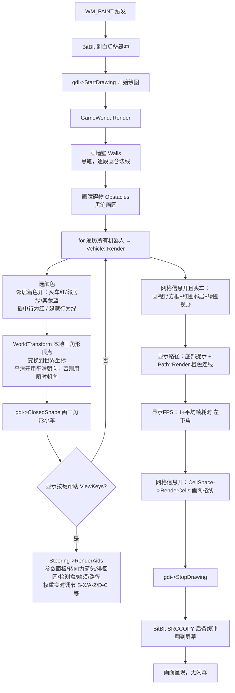

---

## 11. 用户交互处理

### 11.1 键盘（HandleKeyPresses，main.cpp 的 WM_KEYUP 转来）

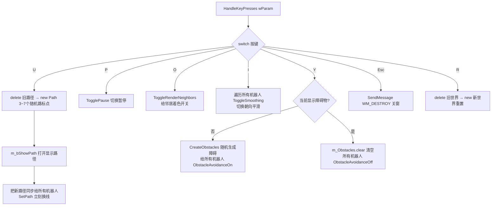

### 11.2 菜单（HandleMenuItems，WM_COMMAND 转来）

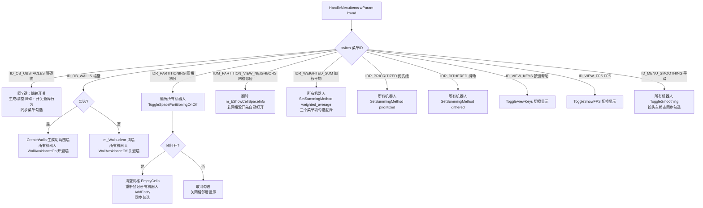

### 11.3 鼠标（SetCrosshair）

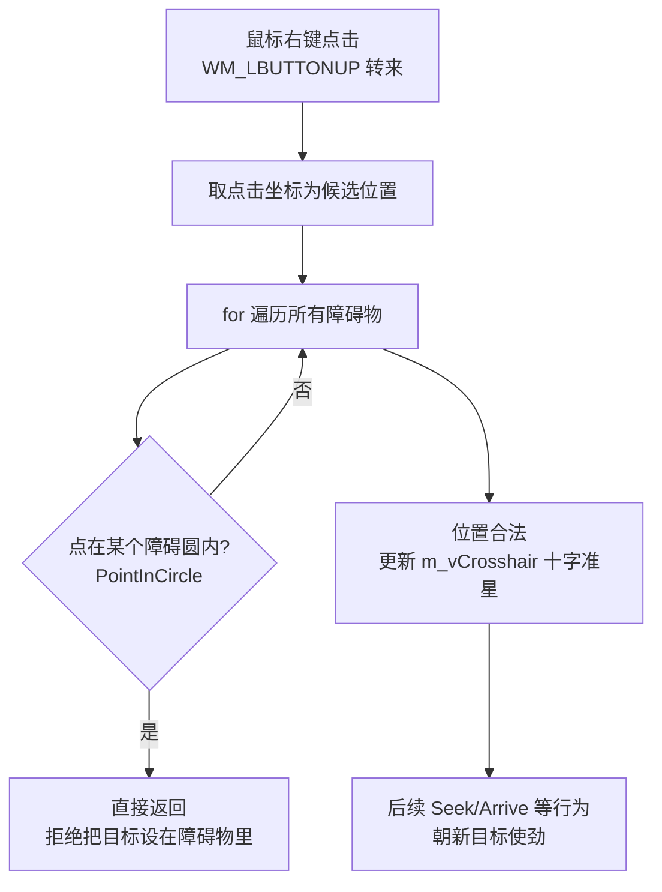

---

## 附：运行期调试键（RenderAids 内）

| 按键 | 作用 | 按键 | 作用 |
|---|---|---|---|
| Insert / Delete | 最大推力 MaxForce ±1000/秒 | F / V | 徘徊抖动 ±1/秒 |
| Home / End | 最大速度 MaxSpeed ±50/秒 | G / B | 徘徊圆距离 ±2/秒 |
| S / X | 分离权重 ±200/秒 | H / N | 徘徊圆半径 ±2/秒 |
| A / Z | 对齐权重 ±200/秒 | D / C | 内聚权重 / 路标切换距离 ± |
