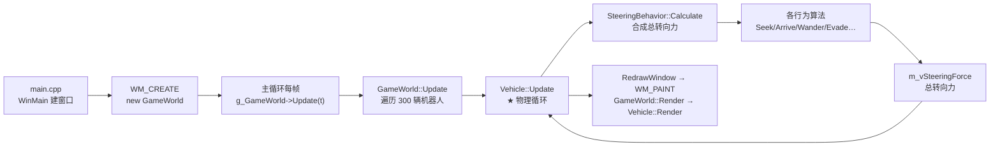

# Steering 工程阅读源码流程（Buckland 第三章 · Steering Behaviors）

> 工程位置：`Buckland_Chapter3-Steering Behaviors/Steering.sln`
> 本文档回答一个问题：**这份源码该怎么读？** 给出"先跑起来 → 先接口后实现 → 先主干后分支 → 自顶向下"的分阶段阅读路线，每阶段标注目标、要读的文件、关注要点与自检问题。
>
> 配套文档：`2026-1026-00-Steering工程完整流程图.md` 已给出工程的完整运行流程（启动/消息/更新/渲染/交互）。本文档是"阅读路线图"：**按照什么顺序、以什么方法读**。建议两篇配合：本文档指路，流程图文档兜底（卡住时查它）。
>
> 一句话理解本工程：**一个 Windows 图形窗口程序，300 辆"小鱼"机器人通过 16 种转向行为在屏幕上成群飞行**，最后一辆被改造成巨大的"鲨鱼"，其余小鱼全部开启"逃命"行为躲着它。核心是每帧循环执行 **"行为 → 转向力 → 合力 → 加速度 → 速度 → 位置"** 的物理循环。

---

## 目录

1. [阅读前准备](#1-阅读前准备)
2. [总策略：四步阅读法](#2-总策略四步阅读法)
3. [阶段 0：先跑起来，观察现象](#3-阶段-0先跑起来观察现象)
4. [阶段 1：程序入口 main.cpp（骨架）](#4-阶段-1程序入口-maincpp骨架)
5. [阶段 2：实体基石（BaseGameEntity → MovingEntity）](#5-阶段-2实体基石basegameentity--movingentity)
6. [阶段 3：世界容器（GameWorld）](#6-阶段-3世界容器gameworld)
7. [阶段 4：机器人个体（Vehicle）](#7-阶段-4机器人个体vehicle)
8. [阶段 5：行为库（SteeringBehaviors）—— 第三章灵魂](#8-阶段-5行为库steeringbehaviors--第三章灵魂)
9. [阶段 6：配角（Path / Obstacle / ParamLoader / 模板）](#9-阶段-6配角path--obstacle--paramloader--模板)
10. [阶段 7：Common 目录（按需查阅）](#10-阶段-7common-目录按需查阅)
11. [深读技巧：断点、变量、参数实验](#11-深读技巧断点变量参数实验)
12. [常见难点与阅读陷阱](#12-常见难点与阅读陷阱)
13. [附：阅读顺序速查表](#附阅读顺序速查表)

---

## 1. 阅读前准备

**前置知识（不够就边读边补）**

| 知识 | 需要到什么程度 | 在哪里补 |
|---|---|---|
| C++ 继承与虚函数 | 知道"子类自动获得父类成员、virtual 可覆写" | 读 `BaseGameEntity.h` 时自然接触 |
| C++ 模板 `template` | 看得懂 `Smoother<Vector2D>` 这种写法即可 | `EntityFunctionTemplates.h` 有专题注释 |
| 向量运算 | 加法/减法/点积/垂直/归一化/截断 | 读阶段 2 前花 10 分钟扫 `Common/2D/Vector2D.h` |
| Windows 消息循环 | 知道 `WM_CREATE / WM_PAINT / WM_KEYUP` 是什么 | 阶段 1 边读边讲 |

**工具准备**

- Visual Studio（本工程已用 VS2026 工具集 v145 编译成功，Release/Debug 均有 exe）。
- 调试器：断点、单步、监视变量（深读技巧见第 11 节）。
- 本工程的源码文件已带零基础中文注释（每行解释），**阅读成本已大幅降低**；注释与原文并存，先看中文注释抓住逻辑，再看原文核对细节。

**源码清单（本工程 18 个文件 + Common 共享目录）**

```
本工程目录 Buckland_Chapter3-Steering Behaviors/
├── main.cpp                 程序入口：窗口 + 主循环
├── GameWorld.h/.cpp         游戏世界：容器 + 更新/渲染/交互
├── Vehicle.h/.cpp           机器人：转向力 → 运动
├── SteeringBehaviors.h/.cpp 转向行为库（核心）
├── MovingEntity.h           会动实体基类
├── BaseGameEntity.h         实体祖宗类
├── Obstacle.h/.cpp          障碍物（圆）
├── Path.h/.cpp              路径（路标点链表）
├── ParamLoader.h/.cpp       读 params.ini
├── EntityFunctionTemplates.h 打标记/防穿模模板
├── constants.h              窗口尺寸常量
├── params.ini               全部数值参数
└── Common/ 共享目录          各章共用，只使用不修改
```

---

## 2. 总策略：四步阅读法

**① 先跑起来，后读代码。** 先运行 exe 看到"300 条鱼成群飞、大鲨鱼追、小鱼逃"的画面，再读代码就有了"它要干什么"的预期，代码只是回答"怎么做到"。

**② 先头文件（接口），后实现文件（细节）。** 每个类先读 `.h`：看成员变量（它有什么数据）和函数签名（它能干什么），建立"类的地图"；再读 `.cpp` 看具体怎么算。本工程所有 `.h` 顶部都有一段"【文件说明】"，先读它 30 秒就能掌握该文件职责。

**③ 先主干，后分支。** 沿着一条主线读：`main.cpp → GameWorld → Vehicle → SteeringBehavior`。这条线上每一环都只读"每帧必调用的函数"，其余（菜单、渲染、调试辅助）先跳过，第二遍再补。

**④ 自顶向下，按依赖顺序。** 先读被依赖少的（基类、常量），再读依赖多的（GameWorld、SteeringBehavior）——符合编译器的包含顺序，也符合人的认知顺序。

**主线调用链（全文最重要的一张图）：**



---

## 3. 阶段 0：先跑起来，观察现象

| 项 | 内容 |
|---|---|
| **目标** | 建立"程序是什么样"的直观印象，让后面每行代码都有画面可对应 |
| **操作** | 运行 `Release/Steering.exe`（或 VS 里 F5） |
| **看什么** | ① 300 只蓝色小鱼成群飞行（群体行为）；② 最后一只被放大 10 倍、慢速游荡（大鲨鱼）；③ 所有小鱼看到鲨鱼就四散逃命；④ 左下角显示 FPS |
| **动手玩** | 右键点任意位置（设目标点，Seek/Arrive 会朝它飞）；按 `U` 换随机路径；按 `P` 暂停；菜单切换"加权平均/优先级/抖动"三种合力方式，观察鱼群行为差异 |
| **验证点** | 能说出：这个程序"每帧在做什么"？—— 更新世界（让鱼动）＋ 重绘（把画面画出来） |

> 关键观察：鱼群游动时行为非常"顺滑"（朝向平滑器），切换合力方式后鱼群的"性格"明显不同（优先级法最稳、抖动法最跳）。这些现象就是后面代码要解释的东西。

---

## 4. 阶段 1：程序入口 main.cpp（骨架）

| 项 | 内容 |
|---|---|
| **目标** | 理解窗口程序的"生命周期"：窗口怎么来、消息怎么分、每帧做什么 |
| **文件** | `main.cpp`（入口与消息处理）、`constants.h`（窗口尺寸） |
| **耗时建议** | 40~60 分钟 |

**阅读顺序与要点：**

1. 文件顶部"【程序总览】"注释：先读它，全工程的调用流程一句话讲清。
2. `WinMain`（入口函数）：
   - 填充 `WNDCLASSEX` 窗口类（**关键**：`lpfnWndProc = WindowProc`，所有消息都送进 WindowProc）；
   - `RegisterClassEx` 注册 → `CreateWindowEx` 创建（尺寸用 `constants.h` 的 500×500）→ `ShowWindow` 显示；
   - **重点**：创建窗口时系统会立刻发一条 `WM_CREATE` 消息。
3. `WindowProc`（消息处理函数，全程序的心脏）：
   - `WM_CREATE`：取客户区尺寸 → 创建后备缓冲（内存画布，防闪烁）→ **`new GameWorld(cx, cy)` 创建整个世界** → 菜单默认勾选；
   - `WM_KEYUP`：Esc 关窗、R 重置世界、其余交给 `HandleKeyPresses`；
   - `WM_PAINT`：刷白缓冲 → `gdi->StartDrawing` → **`g_GameWorld->Render()`** → BitBlt 翻屏（双缓冲）；
   - `WM_DESTROY`：清理缓冲资源 → `PostQuitMessage` 退出。
4. `WinMain` 末尾的**主消息循环**（游戏循环的标准写法）：
   ```
   while(!bDone){
     while(PeekMessage(...)){           // ① 有消息就处理（翻译+分发）
        if(WM_QUIT) bDone=true;
     }
     if(msg.message != WM_QUIT){
        g_GameWorld->Update(timer.TimeElapsed());  // ② 每帧更新世界（鱼在动）
        RedrawWindow(hWnd, false);                 // ③ 触发 WM_PAINT → 渲染（画面刷新）
        Sleep(2);                                  // ④ 让出 CPU
     }
   }
   ```
   **理解这个循环 = 理解了整个程序的节拍**：消息处理与游戏更新交错进行。

**自检问题（读完应能答）：**
- 世界对象是在哪条消息里创建的？创建时传了什么参数？
- 每帧调用世界哪个函数让"鱼动起来"？哪个消息触发了"画画面"？
- 为什么画面不闪烁？（答：先画到内存缓冲，再一次性 BitBlt 翻屏）
- 按 R 键做了什么？（答：delete 旧世界 → new 新世界，随机场景重置）

> 卡点提示：如果你对 Windows 消息循环完全不熟，本阶段就是最费力的一个。啃完后半程一路顺风——因为之后的文件几乎不再涉及 Windows API。

---

## 5. 阶段 2：实体基石（BaseGameEntity → MovingEntity）

| 项 | 内容 |
|---|---|
| **目标** | 理解"实体"是什么、"会动"意味着什么；这是后面所有类的共同地基 |
| **文件** | `BaseGameEntity.h` → `MovingEntity.h` |
| **耗时建议** | 40 分钟 |

**为什么先读这两个？** Vehicle 继承 MovingEntity，MovingEntity 继承 BaseGameEntity。不先看父类，读 Vehicle 时会处处"不知道这变量哪来的"。

**BaseGameEntity.h 要点：**
- 数据：`m_ID`（唯一编号，`NextValidID()` 静态计数分配）、`m_EntityType`、`m_bTag`（通用标记）、`m_vPos`（位置）、`m_vScale`（缩放）、`m_dBoundingRadius`（包围半径）；
- 接口：`Pos()/BRadius()/ID()/Tag()/UnTag()`，虚函数 `Update/Render/HandleMessage`（基类空实现，子类覆写）；
- **关键逻辑**：`SetScale()` 改缩放时按比例同步更新包围半径（否则"外形变大但碰撞圈不变"）。

**MovingEntity.h 要点：**
- 在基类之上加运动属性：`m_vVelocity`（速度）、`m_vHeading`（朝向，单位向量）、`m_vSide`（侧向，与朝向垂直）、`m_dMass`（质量）、`m_dMaxSpeed`（最大速度）、`m_dMaxForce`（最大推力）、`m_dMaxTurnRate`（最大转向速率）；
- **关键概念：朝向 + 侧向 = 本地坐标系**。`heading` 是"车头方向"，`side = heading.Perp()` 是"车身右侧"，这两个单位向量组成了物体自己的坐标系，后面所有转向力都投影在这两个方向上；
- `RotateHeadingToFacePosition`：用旋转矩阵把朝向转一个不超过 `MaxTurnRate` 的角度去面对目标（用到 `C2DMatrix`）。

**自检问题：**
- 一个实体的"编号"是怎么保证不重复的？（答：函数内静态变量 `NextID`，`return NextID++`）
- `heading` 和 `side` 是什么关系？为什么说它们构成"本地坐标系"？
- 机器人放大 10 倍时发生了什么连带变化？（答：包围半径按比例放大）

---

## 6. 阶段 3：世界容器（GameWorld）

| 项 | 内容 |
|---|---|
| **目标** | 理解世界"装什么、怎么造、每帧驱动谁、和用户交互怎么接" |
| **文件** | `GameWorld.h` → `GameWorld.cpp` |
| **耗时建议** | 60 分钟 |

**GameWorld.h 要点（先看成员，把世界"有什么"装进脑子）：**
- 容器：`m_Vehicles`（300 个机器人）、`m_Obstacles`（障碍）、`m_Walls`（墙壁）；
- 工具对象：`m_pCellSpace`（网格划分器，加速找邻居）、`m_pPath`（路径）；
- 状态：`m_bPaused`（暂停）、`m_vCrosshair`（十字准星 = 鼠标目标点）、一堆 `m_bShowXxx` 显示开关、`m_dAvFrameTime`（平均帧耗时）。

**GameWorld.cpp 要点（按函数读）：**

1. **构造函数**（世界是怎么造出来的）：
   - 建网格 `CellSpacePartition<Vehicle*>`（7×7 格）→ 建默认路径（5 个路标点、循环）；
   - for 循环创建 300 个机器人：随机出生点 → `new Vehicle(this, 位置, 随机朝向, 速度0, 质量, 最大推力, 最大速度150, 最大转向速率, 缩放3)` → `FlockingOn()`（开群体飞行：内聚+对齐+分离+徘徊）→ 加入容器与网格；
   - **条件编译鲨鱼场景** `#ifdef SHOAL`：最后一辆 `FlockingOff()` → `SetScale(10,10)` 放大 → 只开 `WanderOn()` → 降速到 70；其余 299 辆 `EvadeOn(鲨鱼)` 全部开启逃命。
2. **Update**（每帧驱动）：暂停则返回；用 `Smoother<double>` 平滑帧耗时；for 循环逐个调 `m_Vehicles[a]->Update(time_elapsed)`。
3. **Render**（每帧画）：墙壁 → 障碍物 → 逐个 `Vehicle::Render`（网格信息、路径、FPS、网格线按开关画）。
4. **交互**：`SetCrosshair`（右键设目标，拒绝点在障碍物内）、`HandleKeyPresses`（U 换路径 / P 暂停 / O 邻居着色 / I 平滑 / Y 障碍物）、`HandleMenuItems`（障碍/墙/网格/三种合力/平滑/FPS）。

**自检问题：**
- 世界创建时默认生成了障碍物和墙吗？（答：没有，`CreateObstacles/CreateWalls` 被注释，菜单/按键可开）
- 大鲨鱼和普通小鱼的行为分别是什么？（答：鲨鱼只开徘徊；小鱼开群体飞行 + 逃命）
- `Update` 里"逐个驱动机器人"是向哪个类的哪个函数发起的？（答：`Vehicle::Update`）

> 阅读技巧：构造函数里的参数一个个对照 `params.ini`（阶段 6 会细讲），你会发现"参数在哪定义、在哪使用"的关系。

---

## 7. 阶段 4：机器人个体（Vehicle）

| 项 | 内容 |
|---|---|
| **目标** | 理解全工程最核心的物理循环：**力 → 加速度 → 速度 → 位置** |
| **文件** | `Vehicle.h` → `Vehicle.cpp` |
| **耗时建议** | 45 分钟 |

**Vehicle.h 要点：** 继承 MovingEntity，持有两件装备：`m_pSteering`（转向控制器，每帧算力）、`m_pHeadingSmoother`（朝向平滑器，取最近 N 帧平均车头）；还有 `m_vecVehicleVB`（三角形小车的 3 个本地顶点）。

**Vehicle.cpp 要点：**

1. **构造函数**：初始化基类运动属性（初始朝向由旋转角算 `sin/cos`）→ `InitializeBuffer()` 填三角形顶点 → `new SteeringBehavior(this)`（绑定主人）→ `new Smoother<Vector2D>(Prm.NumSamplesForSmoothing, ...)`。
2. **Update —— 全文最重要的一段代码，逐行读：**
   ```
   SteeringForce = m_pSteering->Calculate();     // ① 问行为库要总转向力
   acceleration = SteeringForce / m_dMass;       // ② 牛顿第二定律 F=ma → 加速度
   m_vVelocity += acceleration * time_elapsed;   // ③ 速度 += 加速度 × 时间
   m_vVelocity.Truncate(m_dMaxSpeed);            // ④ 限速：超了截断
   m_vPos += m_vVelocity * time_elapsed;         // ⑤ 位置 += 速度 × 时间
   m_vHeading = Vec2DNormalize(m_vVelocity);     // ⑥ 朝向 = 速度方向（车头朝前）
   m_vSide = m_vHeading.Perp();                  // ⑦ 侧向 = 朝向垂直方向
   WrapAround(m_vPos, cx, cy);                   // ⑧ 屏幕环绕（甜甜圈世界）
   // ⑨ 网格开着 → 更新所在格子；平滑开着 → 更新平滑朝向
   ```
   这 8 行就是"转向行为"体系的物理引擎。**建议在纸上默写一遍**，然后对照每一步问"为什么"。
3. **Render**：按状态选颜色（邻居着色 / 插中红 / 躲藏绿）→ `WorldTransform` 把本地三角形顶点变换到世界坐标 → `gdi->ClosedShape` 画三角形；开平滑用 `SmoothedHeading`，否则用瞬时 `Heading`。

**自检问题：**
- 加速度是怎么来的？（答：总转向力 ÷ 质量）
- 为什么速度要被 `Truncate`？（答：模拟引擎极限——再大的力速度也上不去）
- 屏幕环绕解决了什么问题？（答：300 条鱼永远留在画面里；这也是"防穿模"被注释掉的原因）
- 朝向平滑的意义？（答：某些行为让转向生硬，取最近 N 帧平均后画面顺滑——按 I 键对比）

---

## 8. 阶段 5：行为库（SteeringBehaviors）—— 第三章灵魂

| 项 | 内容 |
|---|---|
| **目标** | 理解"转向力怎么算"（行为算法）＋"怎么合成"（三种合力方式）；这是全章核心，值得拆成三小步 |
| **文件** | `SteeringBehaviors.h` → `SteeringBehaviors.cpp`（约 2100 行，本工程最大文件） |
| **耗时建议** | 2~3 小时，分三次读 |

**第 5.1 步：先读 .h，建立"开关表 + 行为清单"（40 分钟）**

- **位标志 m_iFlags**：一个 int 的 16 个位分别管 16 个行为。读 `enum behavior_type`（`seek=0x00002, flee=0x00004, ... offset_pursuit=0x10000`）和 `On()/xxxOn()/xxxOff()` 三组开关函数——这是行为的"总开关面板"；
- **三种合力方式** `enum summing_method`：`weighted_average`（加权平均）/ `prioritized`（优先级，默认）/ `dithered`（抖动）；
- **每个行为的接口签名**：`Seek/Flee/Arrive/Pursuit/Evade/Wander/ObstacleAvoidance/WallAvoidance/FollowPath/Interpose/Hide/Cohesion/Separation/Alignment` + 网格版 `Plus` 三件套 + `OffsetPursuit`，共 16 个；
- 头部常量：徘徊三参数（`WanderRad=1.2 / WanderDist=2.0 / WanderJitterPerSec=80`）、`WaypointSeekDist=20`。

**第 5.2 步：读 Calculate 家族——"力怎么合成"（40 分钟）**

- `Calculate()` 总入口：清零旧力 → 若群体行为开着先圈邻居（无网格用 `TagVehiclesWithinViewRange` 打标记，有网格用 `CalculateNeighbors`）→ switch 三种合力方式；
- `CalculatePrioritized()`（默认）：**按重要性从高到低逐个加力**——避墙→避障→逃命→逃离→群体三件套→追击→到达→徘徊→拦截→编队→插中→躲藏→沿路径。每加一个力用 `AccumulateForce` 检查额度，**力用尽立刻返回**（低优先级行为轮不到）；
- `AccumulateForce`：保证总力不超过 `MaxForce`；剩余额度不够时"方向照旧、长度塞满剩余空间"；
- `CalculateWeightedSum()`：所有开着的行为力 × 权重全部相加，最后 Truncate（无优先级，简单粗暴）；
- `CalculateDithered()`：按优先级顺序，每帧以概率 `prXxx` 随机挑一个行为出力（期望补偿：力÷概率）。

**第 5.3 步：逐个读行为算法——"每个力怎么算"（1 小时，按分组读）**

| 分组 | 行为 | 一句话核心 | 阅读建议 |
|---|---|---|---|
| 单体 | Seek / Flee | 朝目标/背目标的单位向量 × 最大速度 − 当前速度 | 先读，最简单，公式是"期望速度−当前速度" |
| 单体 | Arrive | 接近目标按减速档减速 | 第二个读，理解减速档 `Deceleration` |
| 单体 | Wander | 车前方徘徊圆上目标点，每帧随机抖动再投影回圆 | 第三个读，理解"时间无关"抖动 |
| 预测 | Pursuit / Evade | 预测目标未来位置：`未来位置 = 当前位置 + 速度×预测时间`，预测时间 = 距离 ÷ 速度之和 | 一起读，互相对照 |
| 预测 | Interpose | 两目标当前中点 → 估到达时间 T → 预测 T 后中点 → Arrive | 组合思维 |
| 预测 | OffsetPursuit | 偏移向量变换到队长世界坐标，预测未来偏移点 → Arrive | 用到坐标变换 |
| 环境 | ObstacleAvoidance | 检测盒长度随速度增长；盒内障碍变换到车头坐标系，找最近交点，侧向推离 + 制动 | 最难的算法之一，建议结合 RenderAids 观察 |
| 环境 | WallAvoidance | 3 根触须探墙，穿墙则沿法线推回 | 先看 `CreateFeelers` |
| 群体 | Separation / Alignment / Cohesion | 分离=Σ背向邻居÷距离；对齐=邻居平均朝向−自己；内聚=Seek 邻居重心 | 三件套一起读，理解"邻居先被打标记" |
| 群体 | SeparationPlus 等 | 同三件套，但邻居来自网格查询 | 与普通版对照，只看差异 |
| 路径 | FollowPath | 距当前路标点 < 20 切换下一个；有路标→Seek，最后→Arrive | 结合 Path 读 |
| 躲藏 | Hide | 每个障碍算背对猎人的藏身点，选最近→Arrive；无障碍→Evade | 辅助 `GetHidingPosition` |

**自检问题：**
- 默认合力方式是什么？它的"优先级顺序"大致是什么？（答：prioritized；避墙避障逃命最高，沿路径最低）
- 力用尽是什么意思？对低优先级行为有什么后果？（答：额度用完就提前返回，后面的行为本帧不参与）
- Seek 的转向力公式？（答：`(归一化(目标−位置)×最大速度) − 当前速度`，即"期望速度−当前速度"）
- 群体三件套在网格开/关两种情况下有什么不同？（答：邻居来源不同：打标记遍历全部 vs 网格查询局部）

---

## 9. 阶段 6：配角（Path / Obstacle / ParamLoader / 模板）

| 项 | 内容 |
|---|---|
| **目标** | 补全"数据从哪来、工具怎么用"，四组各 15~25 分钟 |
| **文件** | `Path.h/.cpp`、`Obstacle.h/.cpp`、`ParamLoader.h/.cpp` + `params.ini`、`EntityFunctionTemplates.h` |

**Path.h/.cpp**：`std::list<Vector2D>` 路标点链表 + 迭代器"书签" `curWaypoint`；`CurrentWaypoint()/SetNextWaypoint()` 是 FollowPath 每次要问的两个接口；`CreateRandomPath` 用"均匀分角 + 随机径向距离"生成一圈随机点；`m_bLooped` 控制走完是否绕回。

**Obstacle.h**：最简单的类——继承 BaseGameEntity，`Render()` 画个黑圈，`Update()` 空（不动）。读它 10 分钟即完，顺便巩固"继承"概念。

**ParamLoader.h + params.ini（重点，参数系统的总开关）：**
- 单例模式：`ParamLoader::Instance()` 全局唯一（构造函数私有，禁止 new）；
- 宏 `#define Prm (*ParamLoader::Instance())`——代码里 `Prm.MaxSpeed` 就是"取唯一实例的 MaxSpeed"；
- 构造函数按 `params.ini` 顺序逐行读参数；**注意 `SteeringForceTweaker=200`**：所有行为权重都要乘它（`MaxSteeringForce = 2.0 × 200 = 400`），调合力强弱只改它一处；
- 对照 ini 认一遍关键参数：`NumAgents=300`、`MaxSpeed=150`、`VehicleScale=3`、`EvadeWeight=0.01`（逃命权重极小）、`FollowPathWeight=0.05`、`ViewDistance=50`、`prXxx` 抖动概率组。

**EntityFunctionTemplates.h**：5 个模板函数——`Overlapped`（障碍生成时不重叠）、`TagNeighbors`（给视野内邻居打标记，群体行为的预处理）、`EnforceNonPenetrationConstraint`（防穿模，本工程被注释不用）、两个线段求交（本工程未用）。**重点读 TagNeighbors**：先 `UnTag()` 清旧标记，再对"非自己且距离平方<范围平方"的实体 `Tag()`。

**自检问题：**
- 想"让鱼群飞得更聚拢"，改哪个参数？（答：`CohesionWeight` 或 `SteeringForceTweaker`）
- `Prm.EvadeWeight` 是 0.01，为什么逃命权重这么小？（答：优先级合成法中逃命排位很高，权重小也能占满额度，见 CalculatePrioritized 顺序）
- 网格开/关时 `TagNeighbors` 还用吗？（答：不开网格时用；开网格时改用网格 `CalculateNeighbors`）

---

## 10. 阶段 7：Common 目录（按需查阅）

**原则：用到再查，不用通读。** Common 是各章共享的工具库，本工程只是"使用者"。按以下触发点查阅：

| 触发点（读哪个文件时卡住） | 去查 |
|---|---|
| 看到 `Vector2D` 的 `.Perp()/.Dot()/.Truncate()/LengthSq()` | `Common/2D/Vector2D.h` |
| 看到 `Vec2DNormalize / PointToLocalSpace / WorldTransform / Vec2DRotateAroundOrigin` | `Common/2D/Transformations.h`、`2D/Geometry.h` |
| 看到 `gdi->xxx` | `Common/misc/Cgdi.h`（绘图单例） |
| 看到 `Smoother<T>` | `Common/misc/Smoother.h`（滑动平均） |
| 看到 `CellSpacePartition<T>`、`AddEntity/CalculateNeighbors/UpdateEntity` | `Common/misc/CellSpacePartition.h`（网格空间划分） |
| 看到 `PrecisionTimer`、`timer.TimeElapsed()` | `Common/Time/PrecisionTimer.h`（高精度计时） |
| 看到 `Wall2D`、`InvertedAABBox2D` | `Common/2D/Wall2D.h`、`2D/InvertedAABBox2D.h` |
| 看到 `iniFileLoaderBase`、`GetNextParameterInt/Float` | `Common/misc/iniFileLoaderBase.h` |

> 其中 `Vector2D` 和 `Transformations` 值得**主动提前读一遍**（各 15 分钟）：整个第三章的算法全部建立在向量运算和坐标变换之上。

---

## 11. 深读技巧：断点、变量、参数实验

读完一遍主干后，用调试器"活读"一遍，比再看两遍代码都有效：

**推荐断点位置（按顺序打断点，F5 运行，逐帧观察）：**

| 断点 | 观察什么 |
|---|---|
| `GameWorld::Update` 入口 | 每帧进来一次；`time_elapsed` 约 0.016~0.02 秒 |
| `Vehicle::Update` 的 `m_vSteeringForce` 行 | 单辆车的力→加速度→速度→位置逐行变化 |
| `SteeringBehavior::Calculate` 入口 | `m_iFlags` 的位值（默认开了哪些行为） |
| `SteeringBehavior::CalculatePrioritized` | 优先级顺序实际走哪些分支 |
| `Seek()` 返回行 | 看"期望速度−当前速度"算出的力 |
| `Wander()` 返回行 | 看徘徊目标点如何每帧抖动 |

**必看变量**：`m_vSteeringForce`、`m_vVelocity`、`m_vPos`、`m_iFlags`、`m_dWeightXxx`。

**参数实验（改 `params.ini` 后重新运行，观察行为变化）：**

| 改什么 | 预期现象 |
|---|---|
| `NumAgents` 300 → 50 | 鱼群变稀，群体行为不明显 |
| `MaxSpeed` 150 → 300 | 鱼更快，转向更"飘" |
| `CohesionWeight` 2.0 → 20.0 | 鱼群聚成一团 |
| `SteeringForceTweaker` 200 → 50 | 所有行为力变小，转向变"软" |
| `EvadeWeight` 0.01 → 1.0 | 逃命力变大，小鱼躲得更猛 |
| `ViewDistance` 50 → 200 | 邻居范围变大，群体行为更强 |

**运行期调试键**（`RenderAids` 提供，按 F 键… 打开按键帮助后可见）：S/X 调分离权重、A/Z 调对齐权重、D/C 调内聚权重、Insert/Delete 调最大推力、Home/End 调最大速度、F/V 调徘徊抖动、G/B 调徘徊圆距离、H/N 调徘徊圆半径——**一边跑一边调，直观理解每个参数的作用**。

**对照实验：** 把 `GameWorld.cpp` 里 `#define SHOAL` 注释掉 → 没有鲨鱼，300 条鱼纯群体飞行；菜单切三种合力方式 → 对比鱼群"性格"；菜单开网格 → 对比群体行为邻居计算方式。

---

## 12. 常见难点与阅读陷阱

| 难点 | 说明 | 破解 |
|---|---|---|
| 向量运算看不懂 | `Perp`（垂直）、`Dot`（点积）、`Truncate`（截断）、`LengthSq`（长度平方）出现频率极高 | 先花 15 分钟读 `Vector2D.h`；每个运算脑补"画在坐标纸上长什么样" |
| 本地坐标 vs 世界坐标 | 避障先"变换到车头系"再算，渲染时"本地顶点→世界坐标" | 记住：**本地以车为原点，世界以屏幕为原点**；`PointToLocalSpace / WorldTransform` 是两组桥 |
| 位标志 `m_iFlags` | 一个 int 同时管 16 个行为开关 | 只记三件事：`|=` 开、`^=` 关、`&` 查；`On(bt)` 返回 `(m_iFlags & bt) == bt` |
| `Prm` 宏与单例 | `Prm.xxx` 到底是啥 | 记住 `#define Prm (*ParamLoader::Instance())`，它就是个"全局参数对象"的缩写 |
| `SteeringForceTweaker` 乘数 | 权重都乘了 200，数值对不上 ini | 先看 `ParamLoader` 构造函数，注意哪些成员乘了 tweaker |
| 条件编译 `#ifdef SHOAL` | 某段代码"时有时无" | 搜索 `#define`/`#ifdef`，注释掉宏即可切换场景 |
| 防穿模被注释 | 鱼为什么挤在一起不穿透？ | 本工程用**屏幕环绕**替代防穿模（鱼永远不会离开屏幕，也就不会和"别人"重叠到可察觉） |
| 网格版 vs 普通版 | Separation 与 SeparationPlus 几乎一样 | 只对比"邻居从哪来"：打标记遍历全列表 vs 网格查询局部 |
| 老代码的笔误/怪命名 | `allignment`、`perpendicuar`、小写 `vehicle.h`、`m_cxClient` 误用 | 注释已逐处标注"原书拼写/笔误，保留原样"；不要"顺手改对"，除非你确定要修改源码 |
| RenderAids 很长 | 约 200 行全是画调试信息 | 第二遍再读；第一遍知道"它画参数面板+各种辅助图形+响应调试键"即可 |

---

## 附：阅读顺序速查表

| 顺序 | 文件 | 一句话内容 | 预计耗时 | 读完的标志 |
|---|---|---|---|---|
| 0 | 运行 exe | 看到 300 鱼 + 鲨鱼场景 | 10 分钟 | 能描述现象 |
| 1 | `main.cpp`、`constants.h` | 窗口生命周期 + 主循环 | 40~60 分钟 | 能画出主循环 4 步 |
| 2 | `BaseGameEntity.h` → `MovingEntity.h` | 实体地基 + 运动属性 | 40 分钟 | 能解释 heading/side |
| 3 | `GameWorld.h/.cpp` | 世界容器与每帧驱动 | 60 分钟 | 能讲构造函数造了什么 |
| 4 | `Vehicle.h/.cpp` | 力→加速度→速度→位置 | 45 分钟 | 能默写 Update 8 行 |
| 5 | `SteeringBehaviors.h/.cpp` | 行为算法 + 三种合力 | 2~3 小时 | 能讲 CalculatePrioritized 顺序 |
| 6 | `Path` / `Obstacle` / `ParamLoader` / `EntityFunctionTemplates` | 数据源与工具 | 60 分钟 | 能说出 Prm 怎么用 |
| 7 | `Common/`（按需） | 向量/几何/变换/网格/平滑 | 弹性 | 卡住能自己找到工具 |

**读完的终极检验**：不看代码，用一段话向别人讲清"一辆鱼在一帧里经历了什么"（答案：行为库按优先级合成转向力 → 力÷质量=加速度 → 速度累加并限速 → 位置累加 → 朝向对准速度方向 → 环绕屏幕 → 平滑朝向），并能解释每个环节对应哪份文件的哪个函数。
