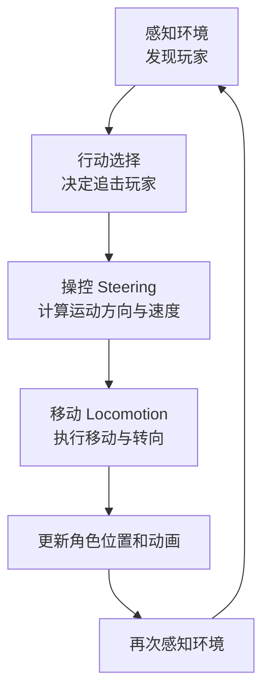

# 游戏 AI 的三个核心步骤：行动选择、操控与移动

在电子游戏 AI 开发中，**行动选择（Action Selection）、操控（Steering）、移动（Locomotion）** 可以理解为控制游戏角色的三个不同层次。

例如，在 Unity 中制作一个敌人 AI：敌人发现玩家后，决定追击玩家，接着计算如何绕开障碍物，最后真正移动角色。这三个过程分别对应不同的职责。

## 一、行动选择（Action Selection）

**核心问题：角色应该做什么？**

行动选择负责根据感知信息、角色状态和游戏规则，决定角色下一步执行什么行为。

### 1. 示例

- 发现玩家 → 追击
- 生命值过低 → 逃跑
- 玩家进入攻击范围 → 攻击
- 没有目标 → 巡逻

### 2. 常用技术

- **有限状态机（FSM）**：通过状态和转换规则选择行为。
- **行为树（Behavior Tree）**：通过节点组织复杂的行为逻辑。
- **效用 AI（Utility AI）**：为不同的行为计算效用分数，选择当前最合适的行为。

### 3. 示例代码

```csharp
// 根据当前情况选择行为
if (playerInAttackRange)
{
    stateMachine.ChangeState(AttackState);
}
else if (playerDetected)
{
    stateMachine.ChangeState(ChaseState);
}
else
{
    stateMachine.ChangeState(PatrolState);
}
```

以上代码用于说明决策逻辑，具体状态接口需要根据项目实现。

---

## 二、操控（Steering）

**核心问题：角色应该朝哪个方向、以什么力度运动？**

操控负责根据当前目标和周围环境，计算角色期望的运动方向、速度或转向力度。

它通常不直接负责修改角色的最终位置，而是生成运动意图，交给移动系统执行。

### 1. 常见操控行为

| 行为 | 英文名称 | 作用 |
|---|---|---|
| 寻向 | Seek | 朝目标移动 |
| 逃离 | Flee | 远离目标 |
| 抵达 | Arrive | 接近目标时逐渐减速 |
| 漫游 | Wander | 产生自然的随机移动 |
| 障碍规避 | Obstacle Avoidance | 避开运动路径上的障碍物 |
| 群体分离 | Separation | 避免与附近个体过于接近 |
| 群体一致 | Alignment | 使运动方向趋向附近群体的平均方向 |
| 群体凝聚 | Cohesion | 使个体趋向附近群体的中心 |

### 2. 示例：Seek

假设敌人需要追击玩家，可以通过玩家与敌人的位置计算期望运动方向：

```csharp
Vector3 direction =
    (target.position - transform.position).normalized;
```

这里得到的 `direction` 表示从敌人当前位置指向目标的单位方向向量。

如果需要计算更完整的操控结果，还可以结合期望速度、当前速度和最大转向力等因素。

### 3. Boids 与操控的关系

Craig Reynolds 提出的 Boids 群体模拟算法，是理解 Steering 的经典案例。

Boids 通常通过三种局部规则产生群体运动：

- **Separation（分离）**：避免个体彼此过近。
- **Alignment（一致性）**：使个体运动方向趋于一致。
- **Cohesion（凝聚）**：使个体靠近邻近群体的中心。

这些规则产生的运动意图可以组合起来，再交给移动系统执行。

需要注意：Boids 是一种群体行为模型，并不等同于全部 Steering 技术。

---

## 三、移动（Locomotion）

**核心问题：如何真正执行运动？**

移动负责将操控层输出的运动指令转化为游戏世界中的实际运动。

### 1. 主要职责

- 更新角色的位置。
- 控制角色的移动速度。
- 控制角色的旋转与转向。
- 处理加速、减速等运动效果。
- 根据运动状态播放走路、跑步、转身等动画。
- 根据具体实现处理碰撞和物理约束。

### 2. Unity 中常用的技术

| 技术 | 典型用途 |
|---|---|
| `Transform` | 直接修改位置和旋转 |
| `CharacterController` | 控制角色移动并处理基本碰撞 |
| `Rigidbody` | 通过物理系统驱动运动 |
| `Animator` | 播放和混合角色动画 |
| `NavMeshAgent` | 通过导航系统实现路径规划和角色移动 |

这些组件承担的职责并不完全相同。例如，`Animator` 主要负责动画表现，`NavMeshAgent` 则可以同时处理导航与实际位置更新。

### 3. 示例代码

```csharp
public class CharacterLocomotion : MonoBehaviour
{
    public float moveSpeed = 3f;

    public void Move(Vector3 direction)
    {
        direction.y = 0f;

        if (direction.sqrMagnitude > 1f)
        {
            direction.Normalize();
        }

        transform.position +=
            direction * moveSpeed * Time.deltaTime;
    }
}
```

这是一个简化的移动示例，适用于理解基本原理。正式项目中需要根据需求处理碰撞、旋转、地面检测和物理交互。

---

## 四、三个步骤如何协同工作？

假设正在制作一个 Unity 第三人称射击游戏，敌人需要追击玩家。

### 1. 整体流程



这不是一次性的三个步骤，而是一个持续循环的 AI 控制过程。

### 2. 实际场景

假设敌人正在追击玩家，而玩家突然躲到墙后：

1. **行动选择**：根据感知结果，决定继续追击、寻找玩家，还是切换到其他行为。
2. **操控**：重新计算运动意图。如果需要绕开墙壁，则结合路径规划或障碍规避结果。
3. **移动**：执行运动指令，更新角色的位置、朝向和动画。
4. **再次感知**：获取最新的环境信息，进入下一轮决策。

### 3. 与路径规划的区别

路径规划（Pathfinding）主要解决：

> 从当前位置到目标位置，应该经过什么路线？

操控（Steering）主要解决：

> 角色应该如何调整当前运动，以沿目标方向运动并响应周围环境？

移动（Locomotion）主要解决：

> 如何真正执行运动，并更新角色的位置、朝向及相关表现？

三者可以协同工作，但不是同一个概念。

例如，Unity 的 `NavMeshAgent` 可以负责寻路并执行导航移动。因此，具体项目中不一定需要单独实现全部路径规划和操控逻辑。

---

## 五、在 Unity 中如何划分代码？

为了降低代码耦合，建议将行动选择、操控和移动分别设计成独立模块。

| 模块 | 主要职责 | 示例脚本 |
|---|---|---|
| 行动选择 | 决定当前执行什么行为 | `EnemyStateMachine.cs` |
| 操控 | 计算运动方向和期望速度 | `SteeringController.cs` |
| 移动 | 执行位置、速度和旋转更新 | `CharacterLocomotion.cs` |

### 调用关系示例

```csharp
// 1. 行动选择：决定追击玩家
stateMachine.ChangeState(ChaseState);

// 2. 操控：计算期望运动方向
Vector3 direction =
    steering.GetDirection(target.position);

// 3. 移动：执行运动
locomotion.Move(direction);
```

以上是用于展示模块职责的示意代码，接口名称和实现方式需要根据项目调整。

在实际项目中，行动选择模块通常不必每帧重复切换到同一个状态。状态机应当根据状态转换条件决定是否切换。

---

## 六、三个步骤的核心区别

| 对比维度 | 行动选择 | 操控 | 移动 |
|---|---|---|---|
| 英文 | Action Selection | Steering | Locomotion |
| 核心问题 | 做什么？ | 怎么运动？ | 如何执行？ |
| 输入 | 感知信息、角色状态、游戏规则 | 目标、当前位置、速度、环境信息 | 运动指令、速度、物理约束 |
| 输出 | 当前行为或目标行为 | 期望方向、速度或转向指令 | 实际位置、朝向和运动表现 |
| 典型技术 | FSM、行为树、效用 AI | Seek、Flee、Arrive、Boids | Transform、CharacterController、Rigidbody |

## 七、推荐学习顺序

如果目标是掌握 Unity 游戏 AI，可以按以下顺序学习：

1. **FSM（有限状态机）**：学习角色如何在巡逻、追击、攻击和逃跑之间切换。
2. **Steering Behaviors（操控行为）**：学习 Seek、Flee、Arrive、Wander 和障碍规避。
3. **Locomotion（移动）**：学习角色控制、速度、加速度、转向、碰撞和动画。
4. **Pathfinding（路径规划）**：学习 A*、导航网格与寻路。
5. **Boids（群体行为）**：组合分离、一致性和凝聚规则，实现群体运动。
6. **综合 AI 系统**：把决策、寻路、操控、移动和感知组合成完整的游戏 AI。

## 总结

理解这三个概念时，可以记住：

- **行动选择（Action Selection）**：我现在应该做什么？
- **操控（Steering）**：我应该朝哪个方向、以什么力度运动？
- **移动（Locomotion）**：如何在游戏世界中实际执行运动？

三者相互配合，构成了从高层行为决策到角色实际运动的一条重要控制链路。
